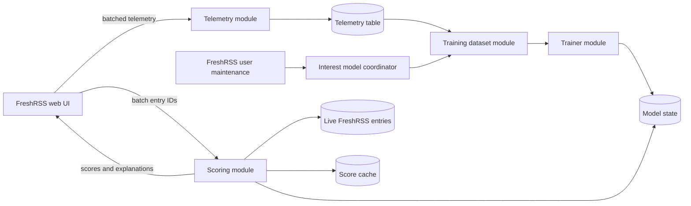

# Server-side interest model design

Status: Phase 1 implemented for extension version 0.4.0  
Last updated: 2026-07-28  
Target: FreshRSS 1.29.1 and later

## Summary

Extend the standalone Interaction Analytics extension with an optional,
server-side interest model. The model will learn from the current user's
interaction telemetry and assign an explainable interest score to new entries.

Training will run inside the FreshRSS server process during per-user
maintenance, never during normal feed browsing. The first implementation will
use a lightweight PHP title classifier so it needs no client export, external
network request, Python runtime, or additional container.

The first user-facing release annotates entries with scores and explanations.
Automatic collapsing is deferred to a later quality-gated release. The model
does not delete, purge, or automatically mark entries read.

## Motivation

The extension already records useful implicit feedback:

- publisher-link activation is a strong positive signal;
- long active reading time is a weaker positive signal;
- a short measured session without publisher-link activation is a weak
  negative signal;
- GReader read-state-only records indicate that an entry was consumed, but do
  not provide enough information for a positive or negative preference label.

The intended outcome is faster browsing, not merely an analytics dashboard.
The collected data should help rank entries and reduce the attention spent on
repeatedly uninteresting topics while preserving an easy way to inspect every
entry.

## Goals

- Train a separate model for each FreshRSS user on the FreshRSS server.
- Require no browser-side training or manual JSON export.
- Remain compatible with SQLite, PostgreSQL, and MySQL/MariaDB.
- Keep page rendering and telemetry writes fast and independent of training.
- Produce a score and a small explanation for each scored entry.
- Support Latin word phrases and CJK title text.
- Learn only from feeds for which interaction tracking is enabled.
- Make all recommendation behavior opt-in and reversible.
- Preserve the previous valid model when training fails.
- Allow all derived model and score data to be explicitly deleted.

## Non-goals

- Training a large language model.
- Calling a hosted machine-learning provider.
- Running arbitrary user-provided Python from a PHP request.
- Using full article content in the first version.
- Automatically deleting, purging, or marking entries read.
- Guaranteeing that every low-scored entry is uninteresting.
- Sharing models or telemetry between FreshRSS users.
- Modifying FreshRSS core. This remains a standalone user extension.

## Design decisions

### Keep training in the existing extension

The telemetry, training data, model, scores, and presentation belong in the
same standalone extension and the same per-user database. This preserves
locality: deletion, configuration, database compatibility, and privacy rules
remain in one repository.

The trainer will still be a separate internal module. Telemetry ingestion must
not know how the model is trained, and the web presentation must not know how
weights are stored.

### Train in PHP first

The first trainer will implement a bounded, deterministic title classifier in
PHP. A smoothed log-odds model is sufficient for keyword and phrase learning,
is inexpensive to retrain, and can explain a score using the features that
contributed the most.

A Python worker may be considered later only if measured model quality cannot
meet the acceptance criteria. If introduced, it must run server-side and
produce the same model artifact consumed by the scoring module.

### Full retraining instead of online updates

The first implementation will rebuild the model from eligible examples rather
than applying irreversible incremental updates. Interaction rows can evolve:
an initially short, unopened entry can later become a publisher-link open or a
favorite. Full retraining naturally incorporates these label changes and is
expected to remain inexpensive for a personal FreshRSS dataset.

### Rank before filtering

The model output is a score, not a permanent filter decision. The UI may
annotate or collapse low-scored entries, but the user can always reveal them.
This minimizes the cost of false negatives and avoids silently creating a
filter bubble.

## FreshRSS integration

FreshRSS 1.29.1 provides the `FreshrssUserMaintenance` hook. It is invoked by
per-user actualization and may run more than once during a single maintenance
command:

- [`Minz_HookType::FreshrssUserMaintenance`](https://github.com/FreshRSS/FreshRSS/blob/1.29.1/lib/Minz/HookType.php)
- [`cli/actualize-user.php`](https://github.com/FreshRSS/FreshRSS/blob/1.29.1/cli/actualize-user.php)

The extension will register this hook when server-side training is enabled.
The hook will call one idempotent orchestration interface:

```php
TrainingOutcome InterestModelCoordinator::trainIfDue(int $now);
```

`trainIfDue()` will return quickly when training is disabled, not due, already
leased by another process, or lacking enough eligible examples. It will catch
all training failures, record a bounded error message, release its lease, and
allow FreshRSS maintenance to continue.

Telemetry controller actions will only mark the model dirty. They will never
train a model.

## Architecture



### Module interfaces

These are module interfaces, not necessarily PHP `interface` declarations.
Internal data classes may be used without exposing additional seams.

| Module | Interface | Responsibility |
| --- | --- | --- |
| Schema migration | `ensureCurrent(): MigrationResult` | Apply idempotent, cross-database schema upgrades and report readiness. |
| Telemetry | Existing record methods plus favorite and feedback methods | Store raw and explicit interaction signals; mark model state dirty. |
| Interest model coordinator | `trainIfDue(now): TrainingOutcome` | Scheduling, lease acquisition, dataset watermark, atomic model publication, and failure isolation. |
| Training dataset | `build(now, limits): TrainingDataset` | Resolve titles, derive settled labels, tokenize titles, and enforce dataset limits. |
| Trainer | `train(dataset): TrainingResult` | Fit deterministic feature weights, choose a threshold, and calculate validation metrics. |
| Scorer | `scoreEntryIds(ids): ScoreBatch` | Load one model, batch metadata and cache access, and return scores and explanations. |
| Model persistence | `loadCurrent()`, `publish(model)`, `status()` | Store model state and publish a new model atomically. |
| Score persistence | `get(ids, modelVersion)`, `put(scores)` | Cache scores without coupling them to the FreshRSS entry lifecycle. |

The scoring interface is the shared test surface for cached and uncached
results. Cache behavior must not change the returned score or explanation.

## Data model

All tables remain extension-owned and live in the current user's FreshRSS
database. No `user_id` column is needed because FreshRSS already selects a
per-user database.

### Existing telemetry table additions

Add nullable columns to `_interaction_analytics`:

```text
favorite_state       nullable boolean
explicit_feedback    nullable small integer (-1, +1)
feedback_at          nullable timestamp
```

The extension will register `EntriesFavorite`, which is available in FreshRSS
1.29.1, to maintain `favorite_state`. Explicit positive and negative feedback
will be recorded through an authenticated POST controller action.

An explicit negative must not overwrite the raw facts such as link activation
or measured time. Raw facts and derived labels remain distinct.

### Model state table

Create `_interaction_analytics_model` with one logical row:

```text
id                    integer primary key, fixed at 1
model_version         integer
algorithm_version     string
normalization_version nullable string
trained_at            nullable timestamp
last_attempt_at       nullable timestamp
positive_samples      integer
negative_samples      integer
validation_samples    integer
vocabulary_size       integer
decision_threshold    nullable float
quality_gate_passed   boolean
weights_json          nullable text
metrics_json          nullable text
dirty_generation      integer
trained_generation    integer
pending_changes       integer
dirty_since           nullable timestamp
force_retrain         boolean
lease_token           nullable string
lease_expires_at      nullable timestamp
last_error            nullable bounded text
updated_at            timestamp
```

`weights_json` contains a portable model artifact rather than database-specific
JSON. It includes the bias, feature weights, normalization rules, feature
schema version, and explanation metadata.

The initial model version is zero and has no weights. A new model version is
published only after training and validation finish successfully.

### Score cache table

Create `_interaction_analytics_scores`:

```text
entry_id               primary key
feed_id                integer
model_version          integer
score                  float
band                   string
explanation_json       nullable text
scored_at              timestamp
```

A cached score is valid only when `model_version` equals the current model.
Old rows may be lazily replaced and periodically purged. The table has no
foreign key because FreshRSS may purge entries independently.

## Training examples and labels

Only rows meeting all of the following are eligible:

- their feed is currently selected for tracking;
- title text is available from a preserved snapshot or a live FreshRSS entry;
- implicit evidence has not changed during the settlement interval;
- their measurement is not `read-state-only` unless explicit feedback or a
  favorite provides an unambiguous label;
- they resolve to one of the labels below.

The default settlement interval for publisher-link and quick-skip evidence is
one hour. This prevents training on an entry that is still being read or whose
publisher-link state may still change. Explicit feedback and the current
favorite state are deliberate user actions and are eligible immediately.

### Label precedence

Labels are resolved in this order:

1. Explicit feedback: positive or negative, sample weight `3.0`.
2. Current favorite state: positive, sample weight `3.0`.
3. Publisher link opened: positive, sample weight `2.0`.
4. Full web measurement, publisher link not opened, and active time at or below
   the quick-skip threshold: negative, sample weight `1.0`.
5. Everything else: ambiguous and excluded.

The initial quick-skip threshold is two seconds. It should become configurable
only if real data shows that one threshold is not adequate. A zero-second row
is a weak negative, not proof that the title is universally unwanted.

The model will not use `time_spent_ms`, link state, favorite state, or explicit
feedback as input features. They are labels only; using them as features would
leak the outcome into training and would be impossible for unseen entries.

## Feature extraction

Version 1 uses title and feed metadata available before the user opens an
entry:

- Unicode-normalized, case-folded word unigrams;
- word bigrams for short repeated phrases;
- character 2-grams and 3-grams for CJK text;
- the feed ID as one categorical feature.

Entry age, publication hour, article content, dwell time, link state,
favorite state, and feedback are not model features.

Version 1 does not use article content. This keeps scoring inexpensive and
ensures that the feature exists even when FreshRSS has not fetched full text.

Normalization must be deterministic across training and scoring. The model
artifact stores its feature schema and normalization version so incompatible
code cannot silently use old weights.

Feature limits:

- maximum 20,000 training examples;
- maximum 5,000 retained features;
- discard features appearing in fewer than three examples;
- cap title length before tokenization;
- cap the number of generated features per title.

The dataset builder must process entries in batches rather than issuing one
database query per entry.

## Model algorithm

The initial algorithm is a weighted, smoothed log-odds classifier.

For each feature, the trainer counts its weighted positive and negative
occurrences and applies additive smoothing. Its weight represents how strongly
the feature distinguishes positive examples from negative examples. The entry
score is the sigmoid of the learned bias plus the retained feature weights.

The explanation contains at most three strongest positive contributors and
three strongest negative contributors that occurred in the entry. Feed IDs
are rendered as feed names in user-visible explanations.

The trainer uses a chronological validation split: the newest 20 percent of
eligible examples form the validation set. Random splitting is avoided because
near-duplicate entries from the same time period could otherwise inflate
reported quality.

The trainer will report at least:

- positive and negative example counts;
- validation precision and recall for the low-interest decision;
- strong-positive false-negative count;
- vocabulary size;
- training duration;
- model artifact size.

The collapse threshold should prioritize precision when declaring an entry
low-interest. If validation data is insufficient or the configured precision
target cannot be met, the model may provide scores but must not enable
automatic collapsing.

## Scheduling and concurrency

### Eligibility to train

Automatic training is due when all of the following hold:

- server-side training is enabled;
- there are at least 20 positive and 50 negative eligible examples;
- at least 25 changes are pending, or the model is dirty and older than 24
  hours;
- the last training attempt was at least six hours ago;
- no unexpired training lease exists.

The defaults are conservative starting values and may be adjusted after
observing production data.

### Lease protocol

FreshRSS may invoke user maintenance more than once and multiple refresh jobs
may overlap. Training must not hold a database transaction while tokenizing or
fitting the model.

The coordinator will:

1. Claim a short database lease using an atomic conditional update.
2. Capture the current dirty generation and pending-change count.
3. Commit the lease transaction.
4. Build and train outside a database transaction.
5. Publish the completed model in a short transaction.
6. Advance the trained generation and subtract only the captured pending
   changes; newer telemetry remains dirty for the next run.
7. Release the lease in success and failure paths.

Expired leases are recoverable. A crashed trainer cannot permanently block
future training.

### Manual training

The configuration page includes **Request training**. The POST action sets
`force_retrain` and returns immediately with a FreshRSS notification. The next
maintenance run performs the work. A status panel shows whether training is
requested, running, successful, unavailable for insufficient data, or failed.

## Scoring

Add an authenticated, read-only `scores` controller action. It accepts at most
250 numeric entry IDs and returns a compact map keyed by `entry_id`:

```json
{
  "model_version": 4,
  "entries": {
    "123": {
      "score": 0.17,
      "band": "low",
      "positive_reasons": [],
      "negative_reasons": ["bundle", "giveaway"],
      "cached": true
    }
  }
}
```

The scoring module will:

1. Load the current model once per request.
2. Read valid cached scores for the requested model version in one query.
3. Load all missing live entries in one batched lookup.
4. Score missing entries in memory.
5. Write new cache rows in one transaction.
6. Return cached and newly computed results together.

When no valid model exists, the endpoint returns an empty entry map and a
machine-readable status. It must not treat missing scores as zero interest.

The web script will follow the existing analytics display pattern: collect IDs
from the current DOM, request one batch, cache results in the page, and request
only newly loaded IDs after load-more actions.

## User experience and configuration

Add these options, all disabled by default unless stated otherwise:

```text
interest_model_enabled          false
interest_model_auto_train       true when model is enabled
interest_display_mode           "score" (off | score)
interest_explicit_feedback      true when model is enabled
```

The configuration page shows:

- model status and version;
- last successful training time;
- trained/dirty generations and pending example count;
- positive and negative example counts;
- validation metrics;
- selected collapse threshold;
- training duration and model size;
- **Request training** and **Delete model and cached scores** actions.

### Entry presentation

In `score` mode, entries receive a compact interest badge and an explanation
tooltip. A later phase may add `collapse` mode; only entries below the validated
threshold may then be collapsed, while the title, feed, score, explanation, and
**Reveal** action remain visible.

Revealing an entry is not automatically a positive label. Opening its
publisher link, favoriting it, or selecting explicit positive feedback is.

Explicit feedback controls provide:

- **More like this**: explicit positive;
- **Less like this**: explicit negative;
- **Clear feedback**: return to implicit labeling.

Feedback changes invalidate the cached score for that entry and mark the model
dirty. They do not retrain synchronously.

## Historical metadata

Training needs titles. The dataset builder uses the same fallback order as
export:

1. current live FreshRSS entry;
2. preserved `entry_title` snapshot;
3. skip the example when neither is available.

When interest-model training is enabled while historical metadata preservation
is disabled, the configuration page warns that purged entries cannot
participate in future full retraining. Training remains possible from current
entries, so metadata preservation is recommended rather than mandatory.

Existing model weights remain usable after source entries are purged. A later
full retrain may use fewer examples if their titles were not preserved.

## Deletion and lifecycle semantics

Derived data must follow its source data:

- **Delete all data** deletes telemetry, the model, training state, and cached
  scores.
- Deleting selected feeds deletes their telemetry, clears the global model and
  all cached scores, and requests a full retrain from the remaining feeds.
- **Delete model and cached scores** preserves telemetry but resets model state.
- Disabling the model preserves its data but prevents maintenance training,
  scoring requests, feedback controls, and model UI.
- Uninstall behavior remains non-destructive, matching current telemetry
  retention. The README and uninstall UI must state that model data remains
  until explicitly deleted.

Exports do not include the model by default. A future diagnostic export may
include model metadata and metrics but must not be required for operation.

## Performance budgets

- Telemetry writes: no training work; only a cheap dirty-state update.
- Maintenance hook when not due: one bounded model-state query and return.
- Training: target under 5 seconds and 128 MiB additional memory at maximum
  configured dataset size; abort cleanly at hard limits.
- Score endpoint: one model read, batched entry/cache queries, no per-entry SQL.
- Cached scoring of 250 entries: target under 50 ms excluding network latency.
- Uncached scoring of 250 titles: target under 150 ms excluding network
  latency.
- Model artifact: target below 2 MiB.

These are design budgets, not guarantees. Tests and production status should
measure actual duration and size.

## Failure handling

- Catch `Throwable` at the maintenance-hook interface so feed actualization
  continues.
- Never replace the current model until a complete artifact passes validation.
- Retain the previous model after training failure.
- Record only a bounded, sanitized error summary in model state; detailed
  errors go to FreshRSS logs.
- Expire abandoned leases.
- Disable collapse mode automatically when no valid model exists.
- Treat malformed model JSON or an unknown algorithm version as no valid model.
- If score caching fails, return computed scores when safe and log the cache
  failure; cache persistence is not required for correctness.

## Privacy and security

- No telemetry, title, model, or score leaves the FreshRSS server.
- All controller actions require the current authenticated user and CSRF
  protection where state changes occur.
- Training reads only the current user's database.
- Model explanations contain normalized title phrases and feed names; they are
  visible only to that user.
- Training configuration is opt-in.
- The model and scores are treated as derived personal data and participate in
  explicit deletion.
- The PHP implementation must not invoke a shell command or external process.

## Testing strategy

The module interfaces are the test surfaces. Tests should assert outcomes and
remain stable if internal tokenization or storage classes are reorganized.

### Pure training tests

- deterministic model artifact for a fixed dataset;
- label precedence and sample weights;
- settlement interval exclusion;
- Latin normalization and word bigrams;
- Chinese/Japanese character n-grams;
- feature and title limits;
- chronological validation split;
- explanation ordering and limits;
- insufficient-data and quality-gate outcomes.

### Persistence and scheduling tests

- install/migrate on SQLite, PostgreSQL, and MySQL/MariaDB;
- dirty-state updates do not train;
- repeated maintenance-hook calls are idempotent;
- only one concurrent process claims the lease;
- expired lease recovery;
- new telemetry after the captured watermark remains dirty;
- failed training retains the previous model;
- atomic model version publication;
- score cache invalidation by model version;
- selected-feed and all-data deletion semantics.

### Controller and browser tests

- batch score limit and numeric ID validation;
- authenticated and CSRF-protected state changes;
- empty response when no model exists;
- normal, reader, and global FreshRSS views;
- dynamically loaded entries;
- score display mode;
- phase-2 collapse and reveal behavior when that mode is implemented;
- explicit feedback and clear-feedback actions;
- display disabled and extension disabled states;
- no per-entry network or database request pattern.

### FreshRSS 1.29.1 verification

- maintenance training through `FreshrssUserMaintenance`;
- favorites through `EntriesFavorite`;
- existing browser read-state fallback remains operational;
- absence of `EntriesRead` does not affect web-model training.

## Rollout plan

### Phase 1: model storage, scoring, and explicit feedback

- Add migrations, dataset construction, coordinator, trainer, model status,
  maintenance scheduling, batched scoring, cache, score badges, explanations,
  and explicit feedback.
- Compare scores with subsequent real interactions.
- Validate resource budgets and label distributions on production data.

### Phase 2: optional collapse mode

- Enable only when validation meets the configured low-interest precision
  target.
- Keep reveal controls and never remove entries from the DOM.
- Track reveal and subsequent positive interactions for evaluation.

### Phase 3: model refinement

- Adjust label policy, feature limits, or algorithm using measured outcomes.
- Consider a server-side Python worker only if the PHP model demonstrably fails
  the quality target and the additional operational cost is justified.

## Acceptance criteria

- Enabling training does not require a browser export or client-side compute.
- Normal browsing never performs training work.
- Two simultaneous maintenance calls cannot train concurrently.
- Training failure does not fail FreshRSS actualization or destroy the previous
  model.
- A valid model produces deterministic scores and explanations for the same
  title and feed.
- Scoring is batched and respects the performance budgets.
- Missing or insufficient data never causes entries to be classified as low
  interest.
- Collapse mode is opt-in, reversible, and quality-gated.
- Deleting source telemetry deletes or invalidates the appropriate derived
  data.
- FreshRSS 1.29.1 browser telemetry remains supported without `EntriesRead`.

## Resolved implementation decisions

- Explicit feedback overrides favorites and implicit signals until cleared.
- The version-1 quick-skip threshold is global at two seconds.
- Collapse requires at least 50 validation examples, 20 predicted-low examples,
  95 percent low-interest precision, and no strong-positive false negatives.
- Reveal is session-local and is not a training label.
- Feed identity remains an explainable version-1 feature.
- Historical metadata remains optional; model enablement shows a warning rather
  than forcing the setting on.
